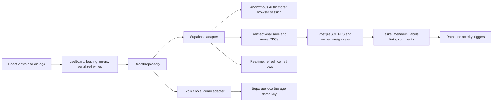

# Architecture and design decisions

## Visual approach

Orbit pairs a deep ink sidebar with a cool off-white work surface and restrained lavender accents. Colors on columns encode workflow states; labels, priority and due-date text provide redundant non-color cues. System typography avoids external font downloads. Compact cards reveal detail through a focused native dialog rather than crowding the board.

The empty-state copy is useful rather than ornamental, example content is explicitly demo-only, and every visible navigation/control maps to implemented behavior. The project name is a deliberate single-board scope, not a nonfunctional project switcher. The layout adapts from four to two to stacked columns, prioritizing readable mobile cards over a tiny four-column desktop imitation.

## Data flow

The pure domain module owns filters, dates, statistics, input validation and deterministic move planning. Components do not construct database queries. The repository interface provides one frontend workflow for two intentionally different persistence modes.

### Authentication

On launch the Supabase adapter checks for a stored session; if absent, it signs in anonymously. An initialization promise deduplicates React StrictMode/concurrent sign-ins. The SDK persists and refreshes the session. No email, password or admin key is requested. Users are separated by a browser-held anonymous account, not a randomly supplied `user_id` parameter.

### Persistence and consistency

- `save_task` uses SECURITY INVOKER and fixed writable fields; it saves a task and its full label set in one transaction.
- `move_tasks` updates a reorder batch in one transaction. A foreign/unavailable task aborts the entire batch.
- Status changes made through the editor append to the destination column. Dragging can insert before a card, reorder within a column, or append to a column's empty area.
- Move planning considers the entire destination column, including filtered-out tasks; integer positions are reindexed deterministically.
- One mutation runs at a time per tab. Realtime reads are debounced; stale in-flight reads cannot overwrite an optimistic write.
- Failed optimistic moves roll back. If a write succeeds but the follow-up read fails, the UI reports that distinction and closes the editor rather than inviting a duplicate write.
- Reads are paginated in 500-row windows; PostgREST's default row cap does not silently hide tasks/comments.
- Realtime is additive: on-drop persistence works without an active websocket, and focus/online events refresh cloud data.

### Ownership and schema

`tasks` includes every required field and the recommended description, priority, due date and assignee. The assignee references `(member_id, user_id)` to enforce same-guest membership. `task_labels` supports multiple labels and references both task and label with owner-aware composite foreign keys. Comments and activity reference the owned task similarly.

All six tables have RLS. Unauthenticated `anon` has no application-table access and no mutation RPC execution. Activity can only be selected by its owner; clients cannot forge, edit or delete events. Restricted SECURITY DEFINER trigger functions insert history with an empty search path and no public execution grants. Task identity/owner/creation time are immutable on update.

The full executable schema is in [001_initial_schema.sql](../supabase/migrations/001_initial_schema.sql), and the submission generator embeds it in both deliverables.

### Accessibility and input safety

Native `<dialog>` handles focus trapping, background inertness and Escape, with explicit initial focus after `showModal()` and focus restoration on close. Inputs have labels; forms remain intact after failure. The board exposes drag screen-reader instructions and announcements. Task details provide a keyboard/touch status alternative. User content is rendered as React text, never raw HTML.

Dates are date-only strings. `parseISO` and local calendar-day differences avoid timezone shifts caused by interpreting a due date as UTC midnight. Completed tasks never count as overdue. Custom colors are validated by SQL and darkened for readable labels/white avatar initials. CSS honors reduced motion.

## Tradeoffs and future improvements

1. **Anonymous lifetime:** convenient zero-friction entry, but no recovery after clearing session storage. Add an explicit opt-in account upgrade for recovery.
2. **Roster, not collaboration:** one optional assignee per task and multiple labels. A team member is a local-to-guest person record, not an authenticated coworker. Add organizations, invitations and role-based shared board permissions only with a new security model.
3. **Single board:** intentional assessment scope; add projects, archive/restore and pagination/virtualization for large workloads.
4. **Whole-snapshot refresh:** simple and predictable at assessment scale; larger datasets should use keyed realtime patches and incremental loading.
5. **Last confirmed write wins across tabs:** writes are serialized per tab, but there is no optimistic-version conflict dialog across different tabs. Add `updated_at`/version checks, operation IDs and conflict resolution for robust collaboration. An ambiguous network failure after commit still requires a read/retry decision; no universal exactly-once delivery is claimed.
6. **Touch drag testing:** touch-safe handles are implemented; mobile Chromium tests cover layout/forms/status changes. Real iOS/Android gesture behavior still needs physical-device validation.
7. **Automation is not certification:** axe checks cover selected screens, not a complete screen-reader or WCAG certification. Add broader AT/browser coverage and manual keyboard audits.
8. **Public signup abuse:** add CAPTCHA, budget monitoring, guest retention and cleanup before unrestricted production exposure. Do not enable mandatory CAPTCHA without adding the widget/token flow.
9. **No optional API server:** Supabase's RLS and RPCs provide the needed database boundary without extra cost, hosting or service-role credential handling.